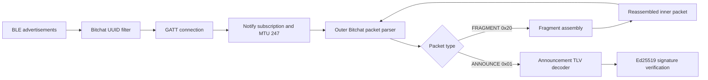

# Bitchat BLE Receiver: Design and Implementation Status

Last updated: 2026-08-11

## Status Summary

The XIAO nRF52840 can discover a Bitchat BLE peer, connect through GATT,
subscribe to notifications, reassemble fragmented Bitchat packets, decode a
version 1 `ANNOUNCE`, and verify its Ed25519 signature.

The receiver path is substantially complete for uncompressed version 1
announcements. Transmitting an announcement, appearing as a peer in the
official app, running the Noise XX handshake, and exchanging messages have not
been implemented yet.

## Current Data Flow



The implementation uses static buffers and does not allocate packet storage on
the heap. This keeps memory behavior predictable on the microcontroller.

## Hardware and Software

- Target: Seeed Studio XIAO nRF52840
- BLE stack: Seeed nRF52/Bluefruit board support package
- Crypto backend: nRF52840 CryptoCell CC310 through Adafruit nRFCrypto
- Serial baud rate: 115200
- Main source: [`sketch_bitchat.ino`](../sketch_bitchat.ino)

## BLE Transport

### UUIDs

| Purpose | UUID |
| --- | --- |
| Bitchat service | `F47B5E2D-4A9E-4C5A-9B3F-8E1D2C3A4B5C` |
| Bitchat characteristic | `A1B2C3D4-E5F6-4A5B-8C9D-0E1F2A3B4C5D` |

The scanner checks the raw little-endian UUID bytes in advertisement data. A
matching device is connected automatically. After service and characteristic
discovery, notifications are enabled and the connection requests an ATT MTU of
247.

Observed successful MTU exchange:

```text
MTU before exchange: 23
Requesting MTU 247... OK
MTU after exchange: 247
```

## Bitchat Packet Format

### Version 1 Header

All multi-byte integer fields use network byte order unless noted otherwise.

| Offset | Size | Field |
| ---: | ---: | --- |
| 0 | 1 | Version |
| 1 | 1 | Message type |
| 2 | 1 | TTL |
| 3 | 8 | Timestamp in milliseconds |
| 11 | 1 | Flags |
| 12 | 2 | Payload length |
| 14 | 8 | Sender ID |
| 22 | 8, optional | Recipient ID |
| variable | payload length | Payload |
| after payload | 64, optional | Ed25519 signature |

Known flag bits:

| Bit | Mask | Meaning |
| ---: | ---: | --- |
| 0 | `0x01` | Recipient ID is present |
| 1 | `0x02` | Signature is present |
| 2 | `0x04` | Payload is compressed |
| 3 | `0x08` | Source route is present in version 2 |
| 4 | `0x10` | RSR state |

The parser also recognizes the version 2 16-byte header and source-route
section, but version 2 traffic has not been fully exercised on the device.

### Message Types Currently Recognized

| Value | Name |
| ---: | --- |
| `0x01` | `ANNOUNCE` |
| `0x02` | `MESSAGE` |
| `0x03` | `LEAVE` |
| `0x04` | `COURIER_ENVELOPE` |
| `0x10` | `NOISE_HANDSHAKE` |
| `0x11` | `NOISE_ENCRYPTED` |
| `0x20` | `FRAGMENT` |
| `0x21` | `REQUEST_SYNC` |
| `0x22` | `FILE_TRANSFER` |
| `0x23` | `BOARD_POST` |
| `0x24` | `PREKEY_BUNDLE` |
| `0x25` | `GROUP_MESSAGE` |
| `0x2C` | `ANNOUNCE_V2` |

Recognition means the type can be named in logs. It does not imply that its
payload is decoded or acted upon.

## Fragmentation and Reassembly

### Fragment Payload

A `FRAGMENT` packet has the following payload layout:

| Offset | Size | Field |
| ---: | ---: | --- |
| 0 | 8 | Fragment ID |
| 8 | 2 | Zero-based fragment index |
| 10 | 2 | Total fragment count |
| 12 | 1 | Original message type |
| 13 | remaining | Fragment data |

The original message type is repeated in every fragment. It is metadata and
must not be included in the reassembled inner packet.

This detail explained the original 171-byte result. A three-fragment announce
contained 168 bytes of actual packet data plus three repeated type bytes:

```text
Fragment data: 64 + 64 + 40 = 168 bytes
Type metadata: 1 + 1 + 1   =   3 bytes
Incorrect result:             171 bytes
Correct result:               168 bytes
```

### Current Assembly Behavior

The assembly logic:

- accepts up to 16 fragments;
- accepts up to 480 data bytes per fragment;
- accepts up to 8192 bytes after reassembly;
- expires an incomplete assembly after 30 seconds;
- ignores duplicate indexes;
- rejects index, total-count, and original-type mismatches;
- validates that the reassembled packet type matches the fragment metadata;
- recursively sends the completed packet back through the normal parser.

Current limitation: only one fragment assembly can be active at a time. A new
fragment ID replaces the existing incomplete assembly. The assembly key also
does not include the sender ID. Supporting multiple simultaneous peers will
require an assembly table keyed by sender ID and fragment ID.

## Announcement Payload

An `ANNOUNCE` payload is a sequence of one-byte type, one-byte length, and value
TLVs.

| Type | Field | Encoding |
| ---: | --- | --- |
| `0x01` | Nickname | UTF-8 text |
| `0x02` | Noise static public key | 32-byte X25519 key |
| `0x03` | Signing public key | 32-byte Ed25519 key |
| `0x04` | Direct neighbors | Zero or more 8-byte peer IDs |
| `0x05` | Capabilities | Minimal little-endian bitfield |
| `0x06` | Bridge geohash | UTF-8 text, up to 12 bytes |

Nickname, Noise public key, and signing public key are required by the current
announcement decoder. Unknown TLVs are logged and skipped.

### Observed Announcement

```text
Version: 1
Type: ANNOUNCE (0x01)
TTL: 7
Flags: 0x02
Payload length: 82
Sender ID: 29-6F-2F-21-F2-88-95-43
Nickname: anon8168
Capabilities: 0x29-03
```

The 82-byte payload is accounted for exactly:

```text
Nickname TLV:      2 + 8  = 10 bytes
Noise key TLV:     2 + 32 = 34 bytes
Signing key TLV:   2 + 32 = 34 bytes
Capabilities TLV:  2 + 2  =  4 bytes
                              --
                              82 bytes
```

The complete packet length is also consistent:

```text
Version 1 header: 14 bytes
Sender ID:         8 bytes
Payload:          82 bytes
Signature:        64 bytes
                  ---
Total:           168 bytes
```

### Observed Capabilities

`29-03` is a minimal little-endian representation of `0x0329`.

| Bit | Capability | Present |
| ---: | --- | --- |
| 0 | `prekeys` | Yes |
| 3 | `groups` | Yes |
| 5 | `vouch` | Yes |
| 8 | `privateMedia` | Yes |
| 9 | `privateMediaReceipts` | Yes |

No direct-neighbor or bridge-geohash TLV was present in the observed packet.

## Peer Identity Check

The sender ID is expected to be the first eight bytes of the SHA-256 digest of
the 32-byte Noise static public key.

The observed key produced:

```text
SHA-256 prefix: 29-6F-2F-21-F2-88-95-43
Sender ID:      29-6F-2F-21-F2-88-95-43
Result:         MATCH
```

This check was performed off-device during development. The firmware does not
currently calculate or enforce the Noise-key fingerprint.

## Ed25519 Signature Verification

### Canonical Signing Data

Bitchat does not verify the signature directly against the received bytes. It
re-encodes an unsigned form of the packet:

1. Remove the 64-byte signature.
2. Set TTL to zero because relays may change it.
3. Remove the signature and RSR flag state.
4. Preserve canonical recipient, compression, and version 2 route flags.
5. Encode the packet again.
6. Apply Bitchat's PKCS#7-style padding to the first fitting 256, 512, 1024, or
   2048-byte bucket when the padding length fits in one byte.
7. Verify the detached 64-byte signature with the announced Ed25519 public key.

For the captured announcement:

```text
Unsigned encoded packet: 104 bytes
Padding byte value:       0x98
Padding length:           152 bytes
Canonical signing data:   256 bytes
Signature result:         VALID
```

The captured sample was verified independently on the development machine.
The firmware implementation uses `CRYS_ECEDW_Verify()` from the nRF52840
CryptoCell CC310 library.

Expected serial output after flashing the current firmware:

```text
Ed25519 verifier: READY
...
Signature verification: VALID (signed data: 256 bytes)
```

Possible failure output:

```text
Signature verification: INVALID (CryptoCell error: 0x...)
```

### Security Meaning

A valid announcement signature proves possession of the private Ed25519 key
corresponding to the signing public key contained in that same announcement. It
does not, by itself, prove possession of the announced Noise static private key.

The sender-ID hash check proves that the sender ID and announced Noise public
key are internally consistent, but an attacker can construct both values from
an arbitrary public key. Possession of the Noise private key must be established
by the authenticated Noise handshake. Parsed, signature-verified, and
Noise-authenticated peer state must therefore remain distinct.

## Implementation Status

| Area | Status | Notes |
| --- | --- | --- |
| BLE advertisement scan | Complete | Filters the raw Bitchat service UUID |
| GATT connection | Complete | Automatic connection after discovery |
| Service discovery | Complete | Bitchat service found successfully |
| Characteristic discovery | Complete | Notify characteristic found |
| Notification subscription | Complete | Incoming Bitchat frames received |
| ATT MTU 247 | Complete | Verified on the live connection |
| Version 1 packet parsing | Complete for current fields | Header and optional sections parsed |
| Version 2 packet parsing | Partial | Header and route parsing implemented, not fully exercised |
| Fragment parsing | Complete | Correct 13-byte fragment header |
| Fragment reassembly | Complete for one active assembly | Concurrent assemblies not supported |
| Announcement TLV decoding | Complete | Required and current optional fields decoded |
| Sender-ID fingerprint | Validated off-device | Not enforced by firmware |
| Signature extraction | Complete | Correct 64-byte location after payload |
| Ed25519 verification | Implemented | Sample vector is valid; on-device result still needs confirmation |
| Compressed payload decoding | Not implemented | Parser logs and skips compressed payloads |
| Peer registry | Not implemented | No persistent verified-peer state |
| ANNOUNCE transmission | Not implemented | Receiver only |
| BLE peripheral role | Not implemented | Firmware currently starts with zero peripheral links |
| Noise XX handshake | Not implemented | Required for authenticated private communication |
| Message transmission | Not implemented | Depends on peer presence and Noise work |

## Resource Limits and Trade-offs

Compile-time limits:

```text
MAX_FRAGMENTS      = 16
MAX_FRAGMENT_DATA  = 480
MAX_REASSEMBLED    = 8192
MAX_SIGNING_DATA   = 2048
```

The current fragment storage reserves approximately 7.7 KiB, and the signing
verification buffer reserves 2 KiB. This is acceptable on the XIAO nRF52840,
but a multi-peer assembly table should allocate entries deliberately rather
than multiplying the current structure without a memory budget.

Signature verification runs synchronously in the notification processing path.
CryptoCell acceleration keeps the operation small, and announcements are
infrequent, but this should be monitored when more traffic types are handled.
If BLE timing is affected, verification should move to a bounded work queue.

## Verification and Build Evidence

- The captured three-fragment announcement reassembled to exactly 168 bytes.
- The payload and complete-packet lengths match every decoded field.
- The observed sender ID matches the Noise public-key SHA-256 prefix.
- The captured Ed25519 signature validates against the reconstructed 256-byte
  canonical signing data.
- The source passes `git diff --check`.
- The sketch passes a C++11 syntax check with the XIAO nRF52840 ARM compiler.
- Object generation with the XIAO toolchain succeeded.
- The linked Adafruit nRFCrypto archive exports `CRYS_ECEDW_Verify`.

A complete Arduino build, upload, and on-device signature result have not been
run from this workspace because Arduino CLI is not installed. The firmware must
still be flashed and the expected `Signature verification: VALID` line observed.

## Next Steps

### Immediate Validation

1. Build and upload the current sketch from Arduino IDE.
2. Confirm `Ed25519 verifier: READY` at startup.
3. Capture one complete announcement.
4. Confirm `Signature verification: VALID`.
5. Record any CryptoCell error code if verification fails.

### Receiver Hardening

1. Add the Noise public-key SHA-256 sender-ID check to the firmware.
2. Introduce a peer registry with parsed, signature-verified, and
   Noise-authenticated states.
3. Replace the single fragment assembly with a bounded table keyed by sender ID
   and fragment ID.
4. Add compressed-payload support if observed traffic requires it.
5. Add replay and timestamp policy before treating announcements as trusted
   presence.

### Transmit and Session Phase

1. Enable the BLE peripheral role and expose the expected Bitchat GATT service.
2. Generate or provision X25519 Noise and Ed25519 signing key pairs.
3. Derive the local sender ID from the Noise public-key SHA-256 prefix.
4. Encode, sign, fragment, and transmit a valid `ANNOUNCE`.
5. Confirm that the official iPhone app displays the XIAO as a peer.
6. Implement the Noise XX handshake and bind the authenticated Noise identity to
   the announced peer state.
7. Implement encrypted message send and receive paths.

## Upstream References

The implementation was compared with the current official Bitchat source on
2026-08-11. Re-check these sources before changing the wire protocol because
the upstream project is active.

- [Binary packet encoding and decoding](https://github.com/permissionlesstech/bitchat/blob/main/localPackages/BitFoundation/Sources/BitFoundation/BinaryProtocol.swift)
- [Packet signing representation](https://github.com/permissionlesstech/bitchat/blob/main/localPackages/BitFoundation/Sources/BitFoundation/BitchatPacket.swift)
- [Message padding](https://github.com/permissionlesstech/bitchat/blob/main/localPackages/BitFoundation/Sources/BitFoundation/MessagePadding.swift)
- [Announcement TLVs](https://github.com/permissionlesstech/bitchat/blob/main/bitchat/Protocols/Packets.swift)
- [Outbound fragment format](https://github.com/permissionlesstech/bitchat/blob/main/bitchat/Services/BLE/BLEOutboundFragmentPlanner.swift)
- [Inbound fragment parsing](https://github.com/permissionlesstech/bitchat/blob/main/bitchat/Services/BLE/BLEFragmentAssemblyBuffer.swift)
- [Protocol whitepaper](https://github.com/permissionlesstech/bitchat/blob/main/WHITEPAPER.md)

