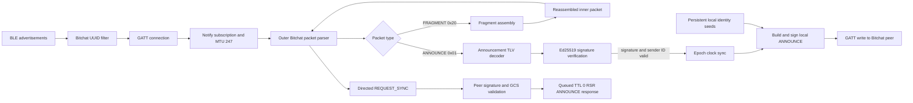

# Bitchat BLE Peer: Design and Implementation Status

Last updated: 2026-08-11

## Status Summary

The XIAO nRF52840 can discover a Bitchat BLE peer, connect through GATT,
subscribe to notifications, reassemble fragmented Bitchat packets, decode a
version 1 `ANNOUNCE`, derive its sender ID from the Noise public key, and verify
its Ed25519 signature. Valid sender-ID and signature results have both been
observed on the XIAO hardware.

The firmware also maintains a local X25519/Ed25519 identity, encodes and signs
a local version 1 `ANNOUNCE`, and writes it to the remote Bitchat
characteristic. The official iPhone app accepted the live outbound
announcement and displayed the XIAO as `xiao52840`. Versioned identity-seed
storage in internal LittleFS is implemented, but persistence across a hardware
reboot still requires an on-device test. The iPhone subsequently advertised
the XIAO sender ID as a direct neighbor and sent a directed, signed
`REQUEST_SYNC`. Request decoding, authentication, GCS membership checking, and
the no-response path for a present GCS member have been verified on-device. A
one-shot forced-missing test also verified the queued TTL-zero RSR announcement
response through a successful 168-byte GATT write. The BLE peripheral role,
the Noise XX handshake, and message exchange have not been implemented yet.

## Current Data Flow



The implementation uses static buffers and does not allocate packet storage on
the heap. This keeps memory behavior predictable on the microcontroller.

## Hardware and Software

- Target: Seeed Studio XIAO nRF52840
- BLE stack: Seeed nRF52/Bluefruit board support package
- Crypto backend: nRF52840 CryptoCell CC310 through Adafruit nRFCrypto
- Serial baud rate: 115200
- Main source: [`sketch_bitchat.ino`](../sketch_bitchat.ino)

## BLE Transport

### UUIDs

| Purpose | UUID |
| --- | --- |
| Bitchat service | `F47B5E2D-4A9E-4C5A-9B3F-8E1D2C3A4B5C` |
| Bitchat characteristic | `A1B2C3D4-E5F6-4A5B-8C9D-0E1F2A3B4C5D` |

The scanner checks the raw little-endian UUID bytes in advertisement data. A
matching device is connected automatically. After service and characteristic
discovery, notifications are enabled and the connection requests an ATT MTU of
247.

The official characteristic supports notification, write, and write without
response. The XIAO therefore sends its first outbound packets over the existing
central-to-peripheral connection; a local GATT peripheral is not required for
this first interoperability test.

Observed successful MTU exchange:

```text
MTU before exchange: 23
Requesting MTU 247... OK
MTU after exchange: 247
```

## Bitchat Packet Format

### Version 1 Header

All multi-byte integer fields use network byte order unless noted otherwise.

| Offset | Size | Field |
| ---: | ---: | --- |
| 0 | 1 | Version |
| 1 | 1 | Message type |
| 2 | 1 | TTL |
| 3 | 8 | Timestamp in milliseconds |
| 11 | 1 | Flags |
| 12 | 2 | Payload length |
| 14 | 8 | Sender ID |
| 22 | 8, optional | Recipient ID |
| variable | payload length | Payload |
| after payload | 64, optional | Ed25519 signature |

Known flag bits:

| Bit | Mask | Meaning |
| ---: | ---: | --- |
| 0 | `0x01` | Recipient ID is present |
| 1 | `0x02` | Signature is present |
| 2 | `0x04` | Payload is compressed |
| 3 | `0x08` | Source route is present in version 2 |
| 4 | `0x10` | RSR state |

The parser also recognizes the version 2 16-byte header and source-route
section, but version 2 traffic has not been fully exercised on the device.

### Message Types Currently Recognized

| Value | Name |
| ---: | --- |
| `0x01` | `ANNOUNCE` |
| `0x02` | `MESSAGE` |
| `0x03` | `LEAVE` |
| `0x04` | `COURIER_ENVELOPE` |
| `0x10` | `NOISE_HANDSHAKE` |
| `0x11` | `NOISE_ENCRYPTED` |
| `0x20` | `FRAGMENT` |
| `0x21` | `REQUEST_SYNC` |
| `0x22` | `FILE_TRANSFER` |
| `0x23` | `BOARD_POST` |
| `0x24` | `PREKEY_BUNDLE` |
| `0x25` | `GROUP_MESSAGE` |
| `0x2C` | `ANNOUNCE_V2` |

Recognition means the type can be named in logs. It does not imply that its
payload is decoded or acted upon.

## Fragmentation and Reassembly

### Fragment Payload

A `FRAGMENT` packet has the following payload layout:

| Offset | Size | Field |
| ---: | ---: | --- |
| 0 | 8 | Fragment ID |
| 8 | 2 | Zero-based fragment index |
| 10 | 2 | Total fragment count |
| 12 | 1 | Original message type |
| 13 | remaining | Fragment data |

The original message type is repeated in every fragment. It is metadata and
must not be included in the reassembled inner packet.

This detail explained the original 171-byte result. A three-fragment announce
contained 168 bytes of actual packet data plus three repeated type bytes:

```text
Fragment data: 64 + 64 + 40 = 168 bytes
Type metadata: 1 + 1 + 1   =   3 bytes
Incorrect result:             171 bytes
Correct result:               168 bytes
```

### Current Assembly Behavior

The assembly logic:

- accepts up to 16 fragments;
- accepts up to 480 data bytes per fragment;
- accepts up to 8192 bytes after reassembly;
- expires an incomplete assembly after 30 seconds;
- ignores duplicate indexes;
- rejects index, total-count, and original-type mismatches;
- validates that the reassembled packet type matches the fragment metadata;
- recursively sends the completed packet back through the normal parser.

Current limitation: only one fragment assembly can be active at a time. A new
fragment ID replaces the existing incomplete assembly. The assembly key also
does not include the sender ID. Supporting multiple simultaneous peers will
require an assembly table keyed by sender ID and fragment ID.

## Announcement Payload

An `ANNOUNCE` payload is a sequence of one-byte type, one-byte length, and value
TLVs.

| Type | Field | Encoding |
| ---: | --- | --- |
| `0x01` | Nickname | UTF-8 text |
| `0x02` | Noise static public key | 32-byte X25519 key |
| `0x03` | Signing public key | 32-byte Ed25519 key |
| `0x04` | Direct neighbors | Zero or more 8-byte peer IDs |
| `0x05` | Capabilities | Minimal little-endian bitfield |
| `0x06` | Bridge geohash | UTF-8 text, up to 12 bytes |

Nickname, Noise public key, and signing public key are required by the current
announcement decoder. Unknown TLVs are logged and skipped.

### Observed Announcement

```text
Version: 1
Type: ANNOUNCE (0x01)
TTL: 7
Flags: 0x02
Payload length: 82
Sender ID: 29-6F-2F-21-F2-88-95-43
Nickname: anon8168
Capabilities: 0x29-03
```

The 82-byte payload is accounted for exactly:

```text
Nickname TLV:      2 + 8  = 10 bytes
Noise key TLV:     2 + 32 = 34 bytes
Signing key TLV:   2 + 32 = 34 bytes
Capabilities TLV:  2 + 2  =  4 bytes
                              --
                              82 bytes
```

The complete packet length is also consistent:

```text
Version 1 header: 14 bytes
Sender ID:         8 bytes
Payload:          82 bytes
Signature:        64 bytes
                  ---
Total:           168 bytes
```

### Observed Capabilities

`29-03` is a minimal little-endian representation of `0x0329`.

| Bit | Capability | Present |
| ---: | --- | --- |
| 0 | `prekeys` | Yes |
| 3 | `groups` | Yes |
| 5 | `vouch` | Yes |
| 8 | `privateMedia` | Yes |
| 9 | `privateMediaReceipts` | Yes |

A later 92-byte announcement payload included one direct-neighbor TLV:

```text
Direct neighbors: 1
  - 25-07-EA-E2-F0-1F-E8-40
```

This value is the XIAO sender ID used by the accepted `xiao52840`
announcement. The live iPhone peer therefore progressed from displaying the
XIAO to including it in its advertised neighbor table. No bridge-geohash TLV
was present.

## Peer Identity Check

The sender ID is expected to be the first eight bytes of the SHA-256 digest of
the 32-byte Noise static public key.

The observed key produced:

```text
SHA-256 prefix: 29-6F-2F-21-F2-88-95-43
Sender ID:      29-6F-2F-21-F2-88-95-43
Result:         MATCH
```

This check was first performed off-device during development. The firmware now
calculates the SHA-256 digest with CryptoCell, prints its first eight bytes, and
compares them with the packet sender ID:

```text
Derived Sender ID: 29-6F-2F-21-F2-88-95-43
Sender ID verification: VALID
```

The on-device fingerprint check has been confirmed with a live announcement.

## Ed25519 Signature Verification

### Canonical Signing Data

Bitchat does not verify the signature directly against the received bytes. It
re-encodes an unsigned form of the packet:

1. Remove the 64-byte signature.
2. Set TTL to zero because relays may change it.
3. Remove the signature and RSR flag state.
4. Preserve canonical recipient, compression, and version 2 route flags.
5. Encode the packet again.
6. Apply Bitchat's PKCS#7-style padding to the first fitting 256, 512, 1024, or
   2048-byte bucket when the padding length fits in one byte.
7. Verify the detached 64-byte signature with the announced Ed25519 public key.

For the captured announcement:

```text
Unsigned encoded packet: 104 bytes
Padding byte value:       0x98
Padding length:           152 bytes
Canonical signing data:   256 bytes
Signature result:         VALID
```

The captured sample was verified independently on the development machine.
The firmware implementation uses `CRYS_ECEDW_Verify()` from the nRF52840
CryptoCell CC310 library.

Expected serial output after flashing the current firmware:

```text
Ed25519 verifier: READY
...
Signature verification: VALID (signed data: 256 bytes)
```

Possible failure output:

```text
Signature verification: INVALID (CryptoCell error: 0x...)
```

### Security Meaning

A valid announcement signature proves possession of the private Ed25519 key
corresponding to the signing public key contained in that same announcement. It
does not, by itself, prove possession of the announced Noise static private key.

The sender-ID hash check proves that the sender ID and announced Noise public
key are internally consistent, but an attacker can construct both values from
an arbitrary public key. Possession of the Noise private key must be established
by the authenticated Noise handshake. Parsed, signature-verified, and
Noise-authenticated peer state must therefore remain distinct.

## Outbound Announcement Prototype

The local announcement uses the following values:

| Field | Current value |
| --- | --- |
| Version | `1` |
| Type | `ANNOUNCE` (`0x01`) |
| TTL | `7` |
| Nickname | `xiao52840` |
| Capabilities | Empty set, encoded as `05-01-00` |
| Sender ID | First 8 bytes of SHA-256 over the local Noise public key |
| Wire packet size | 168 bytes |
| Canonical signing data | 256 bytes |

On the first successful startup, CryptoCell generates independent random seeds
for an X25519 key pair and an Ed25519 key pair. The firmware writes those seeds
to internal LittleFS and derives the runtime key pairs from them. On subsequent
starts, the same seeds are loaded and the same sender ID and public keys should
be derived.

The board has no trusted wall clock. It accepts a timestamp as a clock source
only after the incoming announcement has both a valid sender-ID fingerprint and
a valid Ed25519 signature. The local clock then advances from `millis()`. A
local announcement is sent after synchronization and every 20 seconds while the
link remains active.

Expected transmission log:

```text
Identity filesystem: READY
Local identity storage: CREATED
Local Bitchat identity: READY (persistent)
Local nickname: xiao52840
Local Sender ID: ...
...
Local ANNOUNCE signature self-check: VALID
=== LOCAL ANNOUNCE TX ===
Packet length: 168
GATT write: OK (168 bytes)
```

After a restart, `Local identity storage: LOADED` should replace `CREATED`, and
the sender ID and both public keys should be unchanged.

The firmware prefers write without response, matching the current upstream BLE
sender, and falls back to a write with response when required by the discovered
characteristic.

## Local Identity Persistence

The identity record has a fixed, explicitly serialized 104-byte format. It
does not depend on C structure layout or padding.

| Offset | Size | Field |
| ---: | ---: | --- |
| 0 | 4 | Magic bytes `BCID` |
| 4 | 1 | Record version, currently `1` |
| 5 | 3 | Reserved, must be zero |
| 8 | 32 | X25519 seed |
| 40 | 32 | Ed25519 seed |
| 72 | 32 | SHA-256 over bytes 0 through 71 |

Creation uses `/bitchat_identity.tmp` first. The firmware flushes and closes
the temporary file, reads it back, validates its size and SHA-256 digest, and
checks that both seeds match before renaming it to
`/bitchat_identity.bin`. A complete temporary record left by power loss is
recovered on the next start.

An invalid primary record causes local identity initialization to fail closed;
the firmware does not silently replace it with a different peer identity. The
receive and decode path can still operate, but no local announcement is sent.

The SHA-256 field detects accidental corruption only. It is neither encryption
nor authentication. Both seeds are stored in plaintext internal flash and must
be treated as private key material. The current Seeed `InternalFS.begin()`
implementation formats the LittleFS area after a mount failure, so severe
filesystem damage can still erase the record and cause a new identity to be
created. Hardware-backed key protection and recovery policy remain future
work.

## Request Sync

`REQUEST_SYNC` is a directed, signed, link-local packet. Its TTL must be zero.
The payload uses a one-byte type and a two-byte big-endian length, unlike the
one-byte lengths used by announcement TLVs.

| Type | Field | Encoding |
| ---: | --- | --- |
| `0x01` | Golomb-Rice parameter P | One byte, accepted range 1 through 32 |
| `0x02` | Hash range M | Four-byte big-endian integer |
| `0x03` | GCS data | Up to 1024 opaque bytes, MSB-first bitstream |
| `0x04` | Requested message types | One to eight little-endian bitfield bytes |
| `0x05` | Coverage cursor | Eight-byte big-endian timestamp |
| `0x06` | Fragment stream filter | UTF-8 comma-separated fragment IDs |

The live iPhone request was 115 bytes in total and was directed to the XIAO:

```text
TTL:          0
Flags:        0x03 [recipient, signature]
Payload:      21 bytes
Sender ID:    29-6F-2F-21-F2-88-95-43
Recipient ID: 25-07-EA-E2-F0-1F-E8-40
P:            7
M:            256
GCS data:     4E-58
Types bytes:  03-04
Types value:  0x0403 [announce, message, groupMessage]
```

The firmware now retains the signing key only from a sender-ID-checked and
signature-verified announcement on the active link. A sync request is accepted
only when all of the following are true:

1. TTL is zero.
2. The recipient ID equals the local sender ID.
3. The sender has a verified announcement cached for the active connection.
4. The request signature verifies with that cached Ed25519 key.
5. The required P, M, and GCS-data TLVs are structurally valid.

For an announcement request, the firmware computes the official 16-byte packet
ID as the SHA-256 prefix over `type | sender ID | timestamp | payload`. It maps
that ID into the requested GCS range and decodes the Golomb-Rice bitstream. If
the latest transmitted local announcement is absent, a response is queued for
the Arduino loop instead of writing GATT from the BLE callback.

The response reuses the exact cached announcement, sets TTL to zero, and sets
the RSR flag `0x10`. TTL and RSR are excluded from canonical signing data, so
the existing signature remains valid. Responses are limited to eight per
30-second window.

The complete receive-side path has now been observed on the XIAO with a second
live request:

```text
Recipient verification: VALID
Signature verification: VALID (signed data: 256 bytes)
P: 7
M: 768
GCS data [7 bytes]: AA-8D-B7-0D-AA-60-60
Types raw: 0x07A3
REQUEST_SYNC fields: VALID
Local ANNOUNCE packet ID: 45-CF-B9-52-9C-4E-49-9A-71-9D-9B-0D-13-57-C4-10
GCS membership: PRESENT
REQUEST_SYNC response: not needed
```

This verifies the local-recipient check, cached-peer-key lookup, Ed25519
verification, TLV decoding, packet-ID calculation, GCS decoding, and the
correct suppression of a redundant response.

The transmission branch was then exercised with a compile-time, one-shot
forced-missing hook applied only after all request authentication and parsing
had succeeded:

```text
GCS membership: FORCED MISSING (one-shot test)
REQUEST_SYNC response: RSR ANNOUNCE QUEUED

=== REQUEST_SYNC ANNOUNCE RESPONSE TX ===
TTL: 0
Flags: 0x12 [signature, RSR]
GATT write: OK (168 bytes)
```

The test flag was returned to zero after this result. Normal builds therefore
use the actual GCS membership result.

## Implementation Status

| Area | Status | Notes |
| --- | --- | --- |
| BLE advertisement scan | Complete | Filters the raw Bitchat service UUID |
| GATT connection | Complete | Automatic connection after discovery |
| Service discovery | Complete | Bitchat service found successfully |
| Characteristic discovery | Complete | Notify characteristic found |
| Notification subscription | Complete | Incoming Bitchat frames received |
| ATT MTU 247 | Complete | Verified on the live connection |
| Version 1 packet parsing | Complete for current fields | Header and optional sections parsed |
| Version 2 packet parsing | Partial | Header and route parsing implemented, not fully exercised |
| Fragment parsing | Complete | Correct 13-byte fragment header |
| Fragment reassembly | Complete for one active assembly | Concurrent assemblies not supported |
| Announcement TLV decoding | Complete | Required and current optional fields decoded |
| Sender-ID fingerprint | Complete | `VALID` observed on the XIAO with a live announcement |
| Signature extraction | Complete | Correct 64-byte location after payload |
| Ed25519 verification | Complete | `VALID` observed on the XIAO with a live announcement |
| Compressed payload decoding | Not implemented | Parser logs and skips compressed payloads |
| Active-link verified peer cache | Implemented | One sender ID and Ed25519 key; cleared on disconnect |
| Persistent peer registry | Not implemented | No durable verified-peer or Noise-authenticated state |
| Local identity persistence | Implemented; hardware test pending | Versioned 104-byte LittleFS seed record |
| Local X25519 identity | Implemented | Derived from the stored 32-byte seed |
| Local Ed25519 identity | Implemented | Derived from the stored seed; secret key retained in RAM for signing |
| ANNOUNCE encoding and signing | Implemented | 168-byte wire packet; 256-byte signing representation |
| ANNOUNCE GATT transmission | Complete | Live 168-byte transmission reached the iPhone app |
| Official-app peer display | Complete | `xiao52840` observed in the iPhone app |
| Official-app neighbor registration | Complete | iPhone ANNOUNCE listed the XIAO sender ID as a direct neighbor |
| REQUEST_SYNC TLV decoding | Complete | Live requests with 21-byte and 26-byte payloads decoded on-device |
| REQUEST_SYNC authentication | Complete | Local recipient and Ed25519 signature both reported `VALID` on-device |
| REQUEST_SYNC GCS membership | Complete for present-member path | Packet ID calculated and `PRESENT` observed on-device |
| REQUEST_SYNC RSR response | Complete | TTL 0, flag `0x12`, and 168-byte GATT write observed on-device |
| Public MESSAGE receive and display | Next milestone | Signed UTF-8 payload handling is planned before Noise work |
| BLE peripheral role | Not implemented | Not required for the first central-role transmission test |
| Noise XX handshake | Not implemented | Required for authenticated private communication |
| Message transmission | Not implemented | Depends on peer presence and Noise work |

## Resource Limits and Trade-offs

Compile-time limits:

```text
MAX_FRAGMENTS      = 16
MAX_FRAGMENT_DATA  = 480
MAX_REASSEMBLED    = 8192
MAX_SIGNING_DATA   = 2048
MAX_ANNOUNCE_PACKET = 256
MAX_REQUEST_SYNC_GCS = 1024
```

The current fragment storage reserves approximately 7.7 KiB, and the signing
verification buffer reserves 2 KiB. This is acceptable on the XIAO nRF52840,
but a multi-peer assembly table should allocate entries deliberately rather
than multiplying the current structure without a memory budget.

Signature verification runs synchronously in the notification processing path.
CryptoCell acceleration keeps the operation small, and announcements are
infrequent, but this should be monitored when more traffic types are handled.
If BLE timing is affected, verification should move to a bounded work queue.
Inbound verification and outbound signing share a FreeRTOS mutex so the
CryptoCell backend is never entered concurrently from the BLE callback and the
Arduino loop. Lock acquisition has a one-second timeout and fails closed.

## Verification and Build Evidence

- The captured three-fragment announcement reassembled to exactly 168 bytes.
- The payload and complete-packet lengths match every decoded field.
- The observed sender ID matches the Noise public-key SHA-256 prefix both
  independently and on the XIAO hardware.
- The captured Ed25519 signature validates against the reconstructed 256-byte
  canonical signing data both independently and on the XIAO hardware.
- The locally generated announcement passes its on-device Ed25519 signature
  self-check before transmission.
- The official iPhone app received the local announcement and displayed
  `xiao52840` as a peer.
- A later iPhone announcement listed the XIAO sender ID in its direct-neighbor
  TLV.
- The iPhone sent a signed `REQUEST_SYNC` directly to the XIAO sender ID. Its
  21-byte payload decodes consistently as P 7, M 256, GCS `4E-58`, and
  announcement/message/group-message type flags.
- A later 26-byte request passed local-recipient and Ed25519 verification,
  decoded as P 7 and M 768, calculated the local announcement packet ID, and
  correctly suppressed its response after reporting GCS `PRESENT`.
- A one-shot forced-missing test queued an RSR announcement and completed a
  168-byte GATT write with TTL 0 and flags `0x12`. The test flag was then
  disabled.
- The persistent identity code passes an ARM C++11 object compile, including
  the installed LittleFS and internal-filesystem headers.
- First-boot creation and reboot loading of the identity record have not yet
  been confirmed on the XIAO hardware.
- The source passes `git diff --check`.
- The sketch passes a C++11 syntax check with the XIAO nRF52840 ARM compiler.
- Object generation with the XIAO toolchain succeeded.
- The linked Adafruit nRFCrypto archive exports `CRYS_ECEDW_Verify`,
  `CRYS_ECEDW_Sign`, `CRYS_ECEDW_SeedKeyPair`, and
  `CRYS_ECMONT_SeedKeyPair`.

The verification firmware was built and uploaded through the user's Arduino
environment. `Sender ID verification: VALID` and `Signature verification:
VALID (signed data: 256 bytes)` were both observed for the same live
announcement. The outbound firmware was then uploaded, and `xiao52840` was
observed in the official iPhone app. Arduino CLI is not installed in this
workspace, so builds here use the board package's ARM compiler for syntax and
object checks.

## Immediate Milestone: Public MESSAGE Receive and Display

The next implementation target is deliberately limited to displaying a signed
public `MESSAGE` (`0x02`) from the iPhone on the XIAO serial console. Public
transmission, the BLE peripheral role, Noise, private messages, group-message
decryption, and media are out of scope until this milestone passes.

The current official implementation treats a public `MESSAGE` packet payload
as UTF-8 text directly. It does not use the larger binary `BitchatMessage`
object encoding used by other application paths. The packet header supplies
the sender ID and timestamp, and the display name comes from the previously
verified announcement.

### Phase 1: Capture the Wire Sample

1. Send a short public message from the connected iPhone.
2. Capture the complete `MESSAGE (0x02)` packet, including flags, payload,
   signature, and any fragment sequence.
3. Confirm that the payload bytes decode directly as the text entered on the
   iPhone and that the packet uses the expected signing representation.

Exit criterion: one complete live public-message packet is accounted for byte
by byte.

### Phase 2: Authenticate and Decode

1. Add a `MESSAGE` branch to the packet parser.
2. Require the sender to match the active-link verified peer cache.
3. Require and verify the Ed25519 packet signature with the signing key learned
   from that peer's verified announcement.
4. Reject compressed payloads until decompression support exists.
5. Validate the complete payload as UTF-8 before printing it.
6. Print sender nickname, sender ID, timestamp, TTL, byte length, and content.

Expected output:

```text
--- PUBLIC MESSAGE ---
Sender: anon8168
Sender ID: 29-6F-2F-21-F2-88-95-43
Timestamp (ms): ...
Signature verification: VALID
Content: hello xiao
```

Exit criterion: a correctly signed message is displayed, while a missing or
invalid signature never reaches the content log.

### Phase 3: Acceptance Policy

1. Add a bounded packet-ID ring to suppress duplicate mesh or sync copies.
2. Reject self-echo packets that are not valid solicited responses.
3. Apply the upstream six-hour public-message freshness window using the
   synchronized clock.
4. Continue accepting a message after existing fragment reassembly when the
   inner packet passes the same authentication and freshness checks.

Exit criterion: repeated copies print once, and stale or malformed packets are
logged as rejected without printing attacker-controlled content.

### Phase 4: Hardware Test Matrix

| Case | Expected result |
| --- | --- |
| Short ASCII text | Printed once with valid sender and signature |
| Japanese text and emoji | Printed without UTF-8 corruption |
| Duplicate packet | Second copy suppressed |
| Missing or invalid signature | Rejected before content output |
| Unknown sender ID | Rejected because no verified signing key exists |
| Long fragmented text | Reassembled, authenticated, and printed once |
| Message older than six hours | Rejected by freshness policy |

Completion criterion: all applicable cases pass on the XIAO, with the captured
serial evidence added to this document.

## Deferred Work After Public Receive

1. Encode, sign, and transmit a public `MESSAGE` from the XIAO.
2. Persist or bound a multi-peer verified registry and replace the single
   fragment assembly with a sender-ID/fragment-ID keyed table.
3. Define an explicit local-identity reset and backup policy.
4. Enable the BLE peripheral role for full dual-role mesh participation.
5. Add outbound fragmentation for packets larger than the active link MTU.
6. Implement `Noise_XX_25519_ChaChaPoly_SHA256`, bind the authenticated static
   key to the announcement identity, and receive private messages.
7. Add private-message transmission, receipts, group sessions, and media in
   later milestones.

## Upstream References

The implementation was compared with official Bitchat commit
`9b84b361225facd8e623f25d76f889d3dc54a879` on 2026-08-11. Re-check these
sources before changing the wire protocol because the upstream project is
active.

- [Binary packet encoding and decoding](https://github.com/permissionlesstech/bitchat/blob/main/localPackages/BitFoundation/Sources/BitFoundation/BinaryProtocol.swift)
- [Packet signing representation](https://github.com/permissionlesstech/bitchat/blob/main/localPackages/BitFoundation/Sources/BitFoundation/BitchatPacket.swift)
- [Message padding](https://github.com/permissionlesstech/bitchat/blob/main/localPackages/BitFoundation/Sources/BitFoundation/MessagePadding.swift)
- [Announcement TLVs](https://github.com/permissionlesstech/bitchat/blob/main/bitchat/Protocols/Packets.swift)
- [Outbound fragment format](https://github.com/permissionlesstech/bitchat/blob/main/bitchat/Services/BLE/BLEOutboundFragmentPlanner.swift)
- [Inbound fragment parsing](https://github.com/permissionlesstech/bitchat/blob/main/bitchat/Services/BLE/BLEFragmentAssemblyBuffer.swift)
- [Protocol whitepaper](https://github.com/permissionlesstech/bitchat/blob/main/WHITEPAPER.md)
